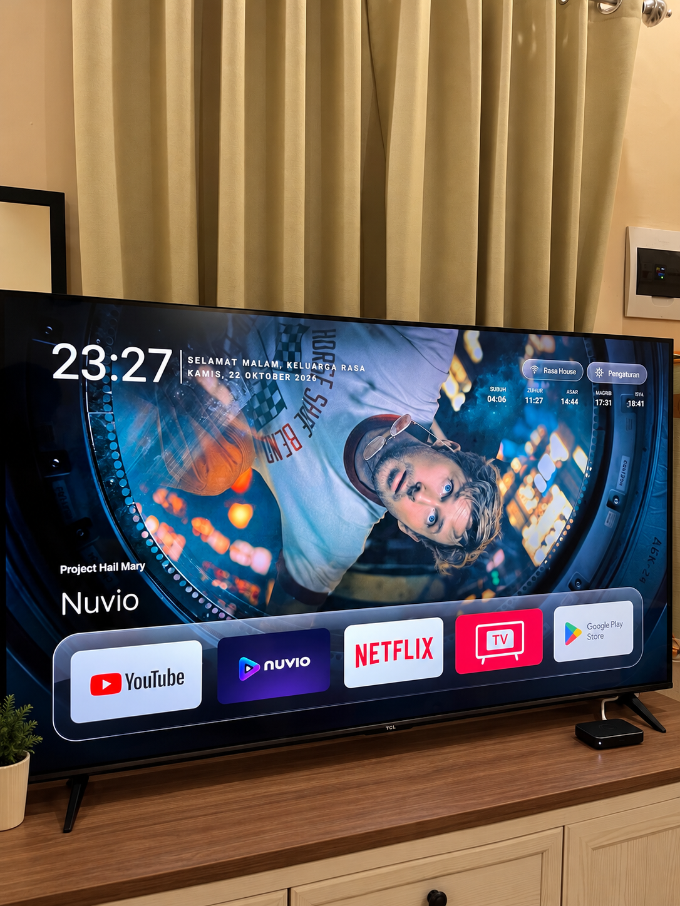
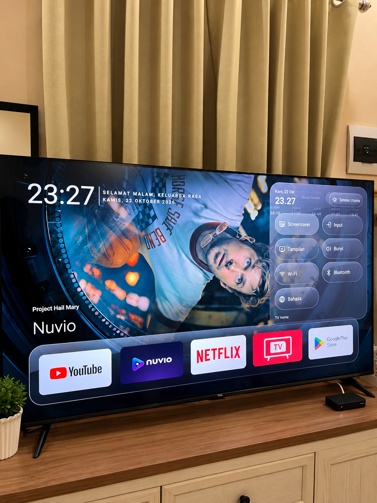

# TV Home Universal


**Your apps, your wallpapers, your home screen.**


A minimal launcher for Android TV and Google TV, featuring a liquid glass interface, remote-friendly controls, customizable widgets, animated screensavers and quick settings.


[English](README.md) | [Bahasa Indonesia](README.id.md)


> **Preview 0.2.1** — Targets Android TV / Google TV 8.0+ (API 26). The APK builds and passes host logic checks, but this universal preview has not been tested on physical TVs. Features and Home-button behavior depend on manufacturer firmware.


## Navigation fixes in 0.2.1

Watch Timer now opens inside the Quick Settings overlay without bringing Home in front of another app. Back returns to Quick Settings. Back from Sound Effects and other Settings Activity submenus restores Settings with the previous row selected. Device verification is still pending. See [release notes](RELEASE-NOTES-0.2.1.md).

## Features


- **A cleaner home screen** — Five favourite apps up front, with more apps available in the grid.

- **Remote-friendly reordering** — Hold an app, move it with the directional buttons, then press OK to save or Back to cancel. Newly installed apps appear automatically.

- **Liquid glass menus** — A consistent translucent appearance across launcher menus and quick settings.

- **Personal widgets** — Toggle the clock, greeting, day/date and prayer schedule individually. Customize the name shown after the time-based greeting.

- **Online and offline wallpapers** — Use the bundled gradients or configure an online image provider with your own credentials where required.

- **Movie and anime categories** — TMDB categories include trending and top-rated movies, series and anime. Anime coverage depends on matching content and available backdrops.

- **Animated screensaver** — Moving clock/date, animated background movement and random image changes every two minutes.

- **Quick settings** — Access screensaver, inputs, display, sound, Wi-Fi, Bluetooth, language and main system settings. Access from other apps depends on the optional accessibility service and firmware.

- **Optional Home override** — An accessibility-based alternative when the system Home picker does not retain the selected launcher.

- **Selectable sound packs** — Choose PS5, PS2 System, Switch, Xbox Series, Persona 5, Pip-Boy or Portal 2. Enable or disable effects and adjust the volume.

- **System language support** — English and Indonesian resources follow the TV language; other locales currently fall back to English.


## Screenshots


### Home




### Quick Settings




## Install


1. Obtain the preview APK from the project's release assets when available.

2. Sideload it using your usual Android TV installation method.

3. Open **TV Home Universal** from the TV's application list.

4. If available, choose it in the system's default Home settings.

5. If needed, enable **Override Launcher** and grant its accessibility permission through system settings.


Keep the stock launcher enabled during initial testing. This project does not include scripts to disable system packages.


The universal app uses `io.github.tvhome.universal`, a separate application ID from the original custom build.


## Everyday controls


| Action | Remote control |

| --- | --- |

| Move focus | Directional buttons |

| Open an app or option | OK |

| Start rearranging an app | Hold OK on the app |

| Move an app while rearranging | Directional buttons |

| Save the new position | OK |

| Cancel rearranging / close a menu | Back |


Dedicated remote shortcut buttons vary by TV model and may require accessibility override.


## Sound packs


Open Settings → Sound Effects. Enable effects, choose one pack and adjust the volume. The selected pack supplies the launcher event sounds; pack choices hide when effects are disabled. PS2 System is the default. Sleep/wake sounds depend on firmware and active service/lifecycle callbacks.


Audio source provenance is listed in [SOUND-SOURCES.json](SOUND-SOURCES.json). Third-party recordings are separate from the MIT code license; see [THIRD_PARTY_NOTICES.md](THIRD_PARTY_NOTICES.md).


## App layouts

Choose **Settings → App Layout**:

- **Classic**: Five favourite apps with the remaining apps in a grid below. This remains the default for the universal build.
- **Horizontal**: All apps in one scrolling row. The first two positions stay still; from the third app onward, the row shifts while the selected app stays at the second slot. Cards are clipped inside the glass panel.

Your choice persists after restart. App order is shared between the two layouts. Each option has its own icon.

## Watch Timer

Open **Settings → Watch Timer**, or select the tile beside Screensaver in Quick Settings. Set a duration from **1 to 240 minutes**, then enable or start the timer.

A small text-only overlay in the upper-right corner shows the remaining time while other apps are open. At expiry, a liquid glass dialog appears over a dark translucent backdrop with a **30-second countdown**, **Sleep** and **Cancel**. Sleep acts immediately; Cancel stops the timer. With no action, sleep is requested at the end of the countdown.

Watch Timer requires Android 9+ and the TV Home accessibility service. Android 12+ may also require permission under **Alarms & reminders**; the app opens that system page when necessary. Android 8 can use the launcher layouts but cannot use Watch Timer. Sleep uses Android's accessibility lock-screen action; its actual effect depends on TV firmware and requires device testing. This is not privileged shutdown.

The timer cancels if the screen turns off manually or the TV restarts. Changing the slider saves the next duration; use Start / Restart to apply it to a running timer. No Shizuku or ADB connection is needed for this feature.

## Personalize


**Widgets:** Open Settings, then Widgets. Enable the items you want, change the greeting suffix, or enter the city, region and country for prayer times. The prayer widget starts disabled. Its calculation uses Muslim World League; compare it with your local mosque's schedule.


**Wallpapers:** Choose an API Source and enter your own API Key if required. For TMDB, select the movie, series or anime categories you want. An image is only available when the provider has a suitable backdrop.


Provider integrations include TMDB, Pixabay, Wallhaven, NASA, Wikimedia, AniList, Jikan, Waifu.im, Danbooru and Safebooru. Availability and credential requirements vary. Unsplash, Pexels and Alpha Coders appear as unavailable in this preview. Online integrations have not been validated across physical TVs.


**Screensaver:** Select TV Home Universal Screensaver in the native screensaver settings. Timeout sliders need special system write permissions; when those are absent, use the provided native-settings button. Automatic screensaver activation and sleep behavior remain controlled by the TV firmware.


## Compatibility and limitations


| Area | Preview behavior |

| --- | --- |

| Android version | Minimum API 26; compiled and targeted against API 34. Physical-device support remains unverified. |

| TV inputs | Uses Android TV input discovery, isolated TCL integrations and native settings fallbacks. TV sticks may not expose antenna or HDMI inputs. |

| Wi-Fi | Android 8–10 use native Wi-Fi settings for selection. SSID/scanning depends on permissions and system policy. |

| Accessibility override | Optional. Firmware may restrict the service or reset its state after reboot. |

| Language | Whole-system changes need permission or use native language settings. |

| Watch Timer | Android 9+, active accessibility service, and exact-alarm permission where required. Sleep and overlays depend on firmware. |
| Power | Opens the native power menu. It does not implement privileged shutdown; Shizuku is not required. |

| Sound | Seven bundled packs cover navigation, confirmation, Back, app launch, menus, toggles and supported sleep/wake events. Only the selected pack is loaded. Sleep audio can be cut short by firmware. |

| Online content | Requires network access; provider terms, credentials, rate limits and content availability apply. |


Before relying on the launcher as Home, test app launch/reordering, Home/Back, quick settings, inputs, network settings, screensaver exit, wake and reboot. A successful build alone does not establish compatibility with a TV model.


## Build on Windows


Requirements:


- JDK 17 or newer.

- Android SDK command-line tools.

- SDK packages `platforms;android-34` and `build-tools;34.0.0`.


Install the SDK packages and accept Google's SDK license yourself. Set `JAVA_HOME` and `ANDROID_HOME`, or pass the SDK directory:


```powershell

powershell.exe -NoProfile -ExecutionPolicy Bypass -File .\tools\Build-Windows.ps1 -SdkDirectory 'C:\Android\Sdk'

```


Output: `dist/TV-Home-Universal-debug.apk`.


The builder does not connect to or install anything on a TV. It generates a development signing key in `.local/debug.keystore`. Preserve that key privately for your own updates. A production release needs a separate signing process.


Run host logic checks with a JDK on PATH:


```powershell

powershell.exe -NoProfile -ExecutionPolicy Bypass -File .\tools\Test-Windows.ps1

```


## Report an issue


Include the TV manufacturer/model, Android version, launcher version, steps to reproduce, and expected versus actual behavior. Screenshots and relevant logs help. Remove API keys, network credentials and personal information before posting.


## Privacy


No project analytics SDK is included. Launcher preferences and wallpaper credentials stay in private app storage. Online providers receive the requests needed for their features. Read [PRIVACY.md](PRIVACY.md) for details.


## Credits and license


Based on [TV Home by Mihir Gupta](https://github.com/mihirgupta0900/tv-home), with the original MIT copyright notice retained. This is an independent derivative.


This product uses the TMDB API but is not endorsed or certified by TMDB. Online imagery belongs to its respective rights holders.


See [LICENSE](LICENSE) and [THIRD_PARTY_NOTICES.md](THIRD_PARTY_NOTICES.md).

